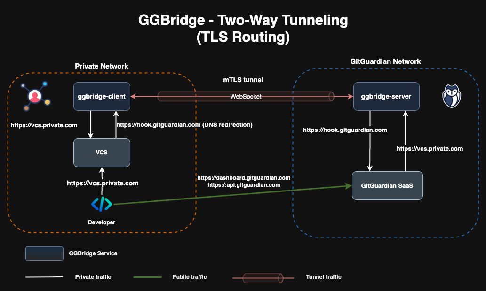

# Enabling 2-Way Tunneling

By default, the `ggbridge` client only lets GitGuardian reach your network (server → client). It exposes no **client → server** path.

With **TLS Routing**, the client also exposes a TLS port. Each TLS connection it receives is forwarded, unopened, through the tunnel to the bridge server, which connects to the host named in the connection's SNI if that host is allowed. Your VCS can then send its webhooks to GitGuardian with no direct internet access. TLS is not terminated on the way: the VCS sees GitGuardian's own certificate, and there is no CA to install.



> [!IMPORTANT]
> 2-way tunneling is for bridges to **GitGuardian SaaS**. For a self-hosted GitGuardian, reverse SOCKS is the only supported tunnel mode: see [values-self-hosted-client.yaml](../helm/values-self-hosted-client.yaml).
> Never enable client tunnels against a bridge server whose `whitelist.hosts` is empty (the chart default): such a server forwards any host name it receives.

## Before you start

- ggbridge Helm chart **1.6.0 or later**. The LoadBalancer option works from 1.0.0, Traefik and Gateway routes from 1.4.0, and the OpenShift resolver setting below needs 1.6.0.
- The hosts of your GitGuardian region. Your bridge URL, shown in the dashboard, tells your region. The bridge server only lets these hosts through, and refuses any other, including other GitGuardian hosts such as the dashboard:

  | Region | Bridge URL (`hostname`)             | Hosts allowed client → server                         |
  | ------ | ----------------------------------- | ----------------------------------------------------- |
  | US     | `<id>.ggbridge.gitguardian.com`     | `hook.gitguardian.com`, `api.gitguardian.com`         |
  | EU     | `<id>.ggbridge.eu1.gitguardian.com` | `hook.eu1.gitguardian.com`, `api.eu1.gitguardian.com` |

- `hook.<region>` receives the webhooks of your VCS. Route `api.<region>` too only if other clients on that network (ggshield, ggscout...) must reach the GitGuardian API through the bridge.

## 1. Enable the TLS tunnel

```yaml
client:
  tunnels:
    tls:
      enabled: true
```

Keep `proxyProtocol.enabled` at its default (`true`): the bridge server expects it on this tunnel.

## 2. Expose the TLS port

> [!NOTE]
> **TLS Routing** does not work with standard `Ingress` objects, which terminate TLS. Use one of the methods below.

### Option A: LoadBalancer Service

Helm values file example 👉 [values-tls-service.yaml](./helm/values-tls-service.yaml)

```yaml
proxy:
  tunnels:
    tls:
      service:
        type: LoadBalancer
        ports:
          tls:
            port: 443
```

The Service, `<release>-proxy-tls` (`ggbridge-proxy-tls` for a release named `ggbridge`), forwards every connection to the tunnel whatever its host name, so this option needs no per-region setting. Note its external IP for step 3:

```console
$ kubectl get service ggbridge-proxy-tls -n ggbridge
NAME                 TYPE           CLUSTER-IP     EXTERNAL-IP   PORT(S)         AGE
ggbridge-proxy-tls   LoadBalancer   10.43.241.16   10.0.0.20     443:31490/TCP   5m
```

- Kubernetes does not provide a load balancer itself: your cloud provider or your cluster must ([Kubernetes documentation](https://kubernetes.io/docs/concepts/services-networking/service/#loadbalancer)).
- On a cloud provider, request an **internal** load balancer with your provider's annotation in `proxy.tunnels.tls.service.annotations`. A public one would let anyone send traffic through your bridge.
- **k3s**: the built-in ServiceLB binds the port on the node itself, and the external IP is the node's IP. The bundled Traefik already holds port 443, so the Service stays `<pending>` until k3s runs with `--disable=traefik`. Alternatively, use Option B with the bundled Traefik.
- **k3d** ([k3d installation](../../docs/k3d-install.md)): that guide disables ServiceLB and Traefik and maps no host port, so the port is not reachable as is. Create the cluster with ServiceLB enabled and `-p "443:443@loadbalancer"`, or use `type: NodePort` with a fixed `nodePort` and `-p "443:<nodePort>@server:0"`.

### Option B: Traefik `IngressRouteTCP`

Requires the Traefik ingress controller in your cluster.

Helm values file example 👉 [values-tls-traefik.yaml](./helm/values-tls-traefik.yaml)

```yaml
proxy:
  tunnels:
    tls:
      ingress:
        enabled: true
        controller: "traefik"
        # Defaults to the US hosts. For the EU region:
        # listeners:
        #   - hostname: api.eu1.gitguardian.com
        #   - hostname: hook.eu1.gitguardian.com
```

Use the external IP of the Traefik LoadBalancer Service in step 3:

```console
$ kubectl get service -n traefik
NAME      TYPE           CLUSTER-IP     EXTERNAL-IP     PORT(S)                      AGE
traefik   LoadBalancer   10.43.65.162   172.31.26.173   80:20572/TCP,443:27014/TCP   29h
```

### Option C: Gateway API

Requires [Gateway API](https://gateway-api.sigs.k8s.io/guides/#getting-started-with-gateway-api) and a [`GatewayClass`](https://gateway-api.sigs.k8s.io/concepts/api-overview/#gatewayclass) in your cluster.

Helm values file example 👉 [values-tls-gateway.yaml](./helm/values-tls-gateway.yaml)

```yaml
proxy:
  tunnels:
    tls:
      gateway:
        enabled: true
        gateway:
          # Creates the Gateway; set to false to use an existing one (see below)
          create: true
          className: "my-gatewayclass"
          # Defaults to the US hosts. For the EU region:
          # listeners:
          #   - hostname: api.eu1.gitguardian.com
          #   - hostname: hook.eu1.gitguardian.com
```

This creates a [`Gateway`](https://gateway-api.sigs.k8s.io/concepts/api-overview/#gateway) and a [`TLSRoute`](https://gateway-api.sigs.k8s.io/concepts/api-overview/#tlsroute). To attach the `TLSRoute` to a Gateway you already manage:

```yaml
proxy:
  tunnels:
    tls:
      gateway:
        enabled: true
        parentRefs:
          - name: my-gateway
            namespace: my-gateway-namespace
        gateway:
          create: false
          # Still sets the TLSRoute hostnames: override it for the EU region
          # listeners: [...]
```

Use the address of the Gateway in step 3:

```console
$ kubectl get gateway
NAME         CLASS             ADDRESS         PROGRAMMED   AGE
my-gateway   my-gatewayclass   192.168.1.200   True         54h
```

### Option D: OpenShift Route

Helm values file example 👉 [values-tls-openshift-route.yaml](./helm/values-tls-openshift-route.yaml)

```yaml
proxy:
  config:
    resolver:
      dns: dns-default.openshift-dns.svc.cluster.local
  tunnels:
    tls:
      openShiftRoute:
        enabled: true
        # Defaults to the US hosts. For the EU region:
        # listeners:
        #   - hostname: api.eu1.gitguardian.com
        #   - hostname: hook.eu1.gitguardian.com
```

Use the address of your OpenShift router in step 3.

## 3. Redirect DNS on the VCS network

Make the VCS resolve the hosts of your region (see [Before you start](#before-you-start)) to the address from step 2.

- **Override exactly these host names**, not the `gitguardian.com` (or `eu1.gitguardian.com`) zone. The bridge refuses every other host, so the dashboard and other GitGuardian services would stop working for that network.
- **Configure it in the DNS server your VCS uses.** For example, an override zone or RPZ entry on your internal DNS server, or a cloud private DNS zone attached to the VCS network. On AWS, that is a Route 53 private hosted zone named after the host itself (`hook.gitguardian.com`) with an A record at its apex.
- **VCS appliances rarely have a DNS setting of their own.** GitHub Enterprise Server, for instance, takes its nameservers from DHCP, or from `ghe-setup-network -v` in its administrative shell ([GitHub documentation](https://docs.github.com/en/enterprise-server@latest/admin/configuring-settings/configuring-network-settings/configuring-dns-nameservers)). The redirection itself belongs in that DNS server.
- **The override applies to every machine that uses this DNS server.** For example, ggshield in CI on that network then reaches `api.<region>` through the bridge, and stops working when the bridge is down.

## 4. Open the firewall

- Allow the VCS to reach the address from step 2 on TCP 443.
- The ggbridge client only needs outbound TCP 443 to its bridge URL, as for any bridge.
- Once step 5 passes, you can close the VCS's direct egress to GitGuardian: that is the point of this setup.

## 5. Verify

From the VCS host (for GitHub Enterprise Server, its administrative shell), with the hosts of your region:

```console
$ getent hosts hook.gitguardian.com
10.0.0.20       hook.gitguardian.com
$ curl -sS -o /dev/null -w '%{http_code} %{remote_ip}\n' https://hook.gitguardian.com/
404 10.0.0.20
```

- The address must be the one from step 2.
- Any HTTP status means GitGuardian answered through the tunnel (`404` on `/` is expected for `hook`). Do not use `-k`: TLS is passed through, so the certificate must be GitGuardian's own and must validate.
- Repeat for `api.<region>` if you route it.
- If the address is right but the connection fails during the TLS handshake, check that the client pods are `Ready`, and that the hosts belong to your bridge's region: the bridge server refuses the others.

See also [Troubleshooting: reverse tunneling](../../docs/troubleshoot.md#4-reverse-tunneling) for a check from inside the cluster.
